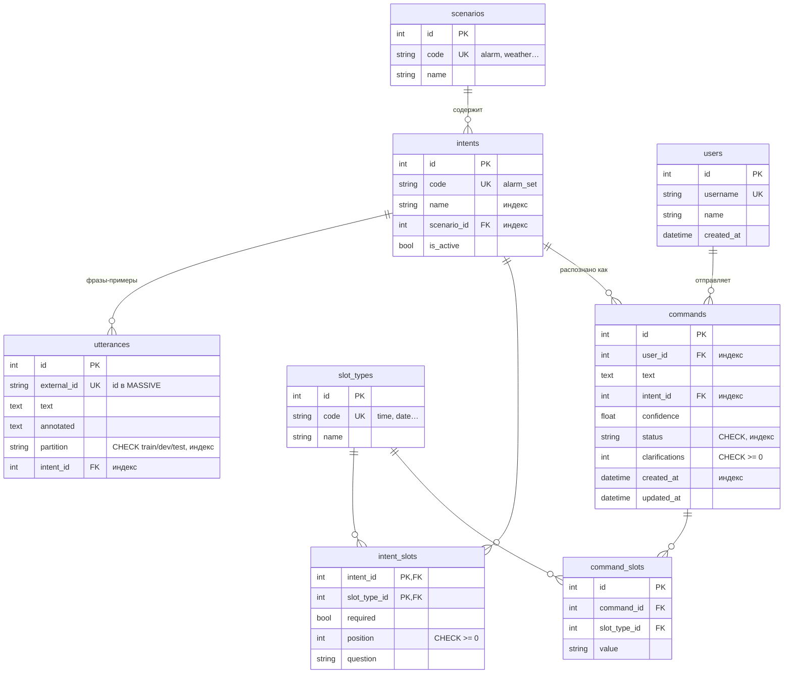

# ERD — структура базы данных

## Связи

| Связь | Тип | Как реализована |
| --- | --- | --- |
| Сценарий → намерения | один-ко-многим | `intents.scenario_id` |
| Намерение → фразы | один-ко-многим | `utterances.intent_id` |
| Намерения ↔ типы параметров | **многие-ко-многим** | ассоциативная таблица `intent_slots` (с атрибутами: обязательность, порядок, вопрос) |
| Пользователь → команды | один-ко-многим | `commands.user_id` |
| Команды ↔ типы параметров | **многие-ко-многим** | `command_slots` (значение параметра в команде), `UNIQUE (command_id, slot_type_id)` |

## Ограничения целостности

- `NOT NULL` — на всех полях, кроме необязательных (их в схеме нет);
- `UNIQUE` — коды справочников, `username`, `utterances.external_id` (на нём держится идемпотентность ETL), пара `(command_id, slot_type_id)`;
- `CHECK` — допустимые `partition` и `status`, `clarifications >= 0`, `position >= 0`;
- индексы — на полях поиска и фильтрации: `intents.name`, `intents.scenario_id`, `utterances.partition`, `commands.status`, `commands.user_id`, `commands.created_at` и другие внешние ключи.
