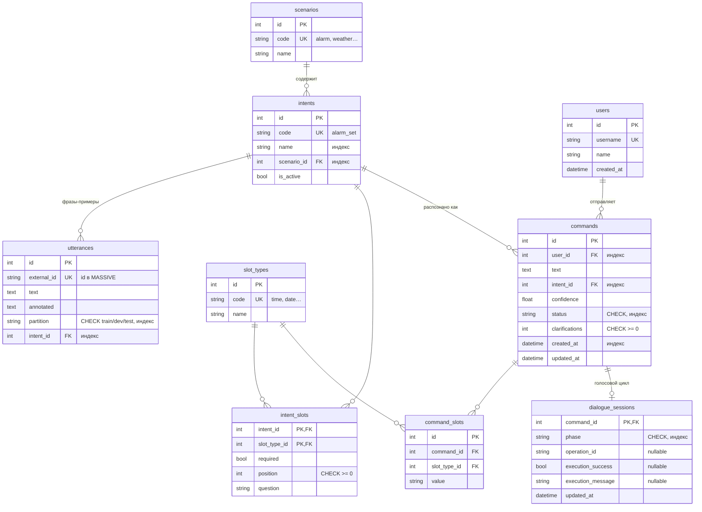

# ERD — структура базы данных

Полная схема для презентации: [SVG](../app/static/assets/erd.svg).
Показаны все 9 прикладных сущностей, 45 атрибутов и 9 FK-связей, включая
необязательную связь команды с диалогом 1:0..1. PK — первичный ключ, FK — внешний,
UQ — уникальность, знак ? после типа допускает NULL.

SVG строится непосредственно из метаданных ORM без обращения к БД:
`python -m scripts.render_erd`. Служебная alembic_version не является сущностью
предметной области и в диаграмму не включена.

## Связи

| Связь | Тип | Как реализована |
| --- | --- | --- |
| Сценарий → намерения | один-ко-многим | `intents.scenario_id` |
| Намерение → фразы | один-ко-многим | `utterances.intent_id` |
| Намерения ↔ типы параметров | **многие-ко-многим** | ассоциативная таблица `intent_slots` (с атрибутами: обязательность, порядок, вопрос) |
| Пользователь → команды | один-ко-многим | `commands.user_id` |
| Намерение → команды | один-ко-многим | `commands.intent_id` |
| Команды ↔ типы параметров | **многие-ко-многим** | `command_slots` (значение параметра в команде), `UNIQUE (command_id, slot_type_id)` |
| Команда → голосовой диалог | один-к-нулю-или-одному | `dialogue_sessions.command_id` одновременно PK и FK; старые команды могут не иметь голосового диалога |

## Ограничения целостности

- `NOT NULL` — на обязательных полях; поля квитанции dialogue_sessions остаются NULL до ответа исполнителя;
- `UNIQUE` — коды справочников, `username`, `utterances.external_id` (на нём держится идемпотентность ETL), пара `(command_id, slot_type_id)`;
- `CHECK` — допустимые `partition` и `status`, `clarifications >= 0`, `position >= 0`;
- индексы — на полях поиска и фильтрации: `intents.name`, `intents.scenario_id`, `utterances.partition`, `commands.status`, `commands.user_id`, `commands.created_at` и другие внешние ключи.

Всего 9 таблиц. dialogue_sessions расширяет команду фазой согласования и исполнения;
внутренний commands.status=completed означает собранные параметры, а не работу устройства.
